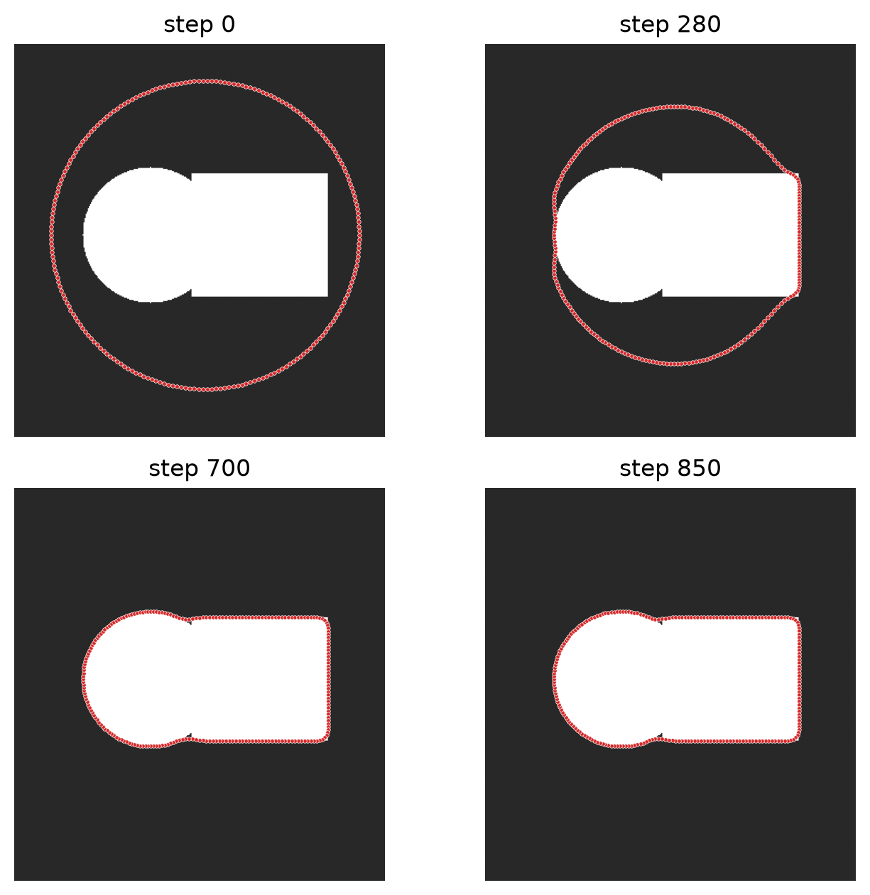
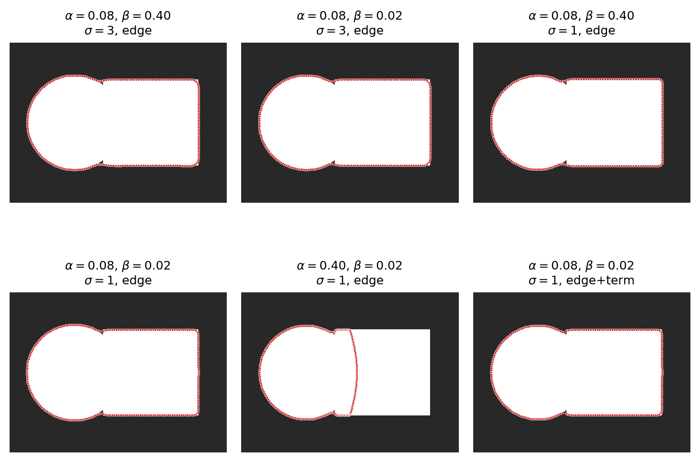
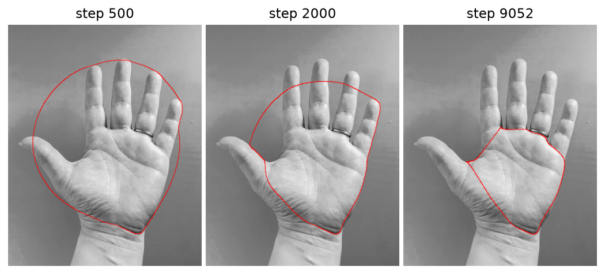
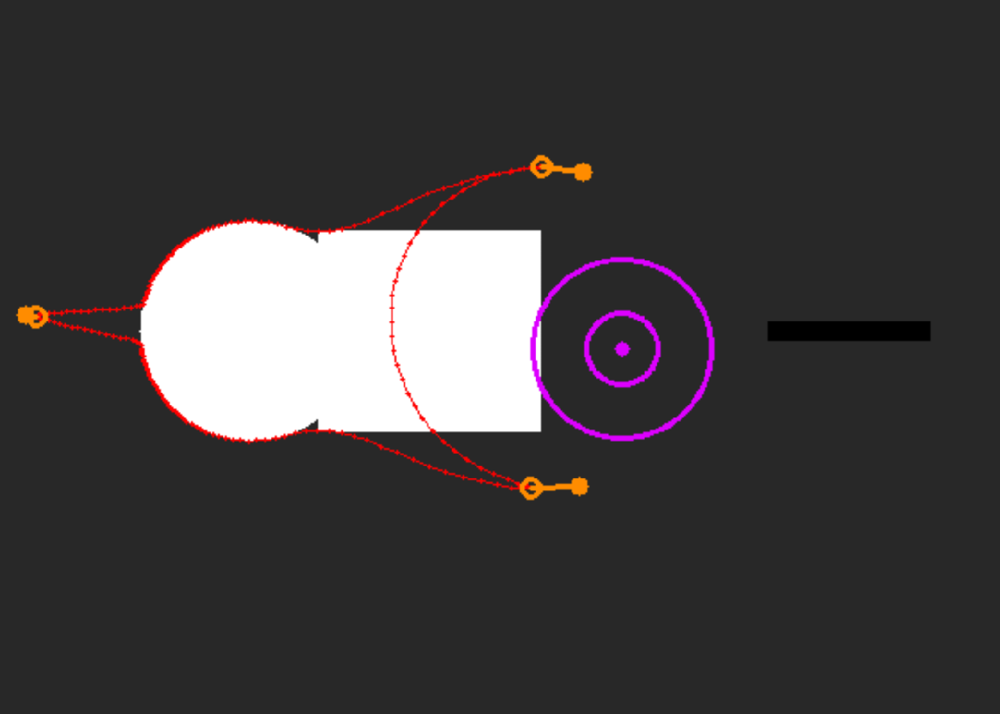

# Active Contours (Kass Snakes), Implemented from the Paper

NumPy and OpenCV implementation of the active-contour model introduced by Kass, Witkin, and Terzopoulos in 1988.

<!-- TODO: after recording, embed docs/demo.gif here. Sequence: uv run snake.py --image coins.jpg, circle around one coin, let it settle on the rim, press p, click a volcano on that rim. Crop to the image window. -->



**[Read the full technical report](report/snakes-report.pdf)**

## What I implemented

The active-contour solver is this repository. OpenCV supplies blur, Sobel derivatives, and the window. NumPy supplies the matrix algebra.

- A closed snake is a loop of vertices, drawn as a circle or a polyline and resampled to about one vertex every four pixels of perimeter.
- Tension (α) and bending (β) form a wrapped pentadiagonal stiffness matrix, `A = -α D₂ + β D₄`.
- Line, edge, and termination energies are weighted, normalized, and sampled with bilinear interpolation at each vertex.
- Each iteration is Kass's implicit Euler step. `A + γI` is inverted once and reused.
- Springs pull vertices toward anchors or other vertices. Volcanoes repel the contour outside a crater.
- Auto-finish repeats the solve at Gaussian scales σ = 5, then 3, then 1.5.

## How it works

```text
Image
  ↓
Gaussian smoothing
  ↓
Line / Edge / Termination Energy
  ↓
Image Force
  ↓
Bilinear Sampling at Snake Vertices
  ↓
Implicit Snake Update
  ↓
Updated Contour
```

`A` holds the contour toward a shorter, smoother loop. Image forces and interactive constraints move the vertices. γ weights staying near the current contour. κ scales the image force; springs and volcanoes are added after that scale. The energies and the update follow Kass, Witkin, and Terzopoulos. The equations are in the report.

## Why the implicit update matters

Bending at a vertex depends on neighbors two steps away. Adding those forces and stepping forward throws the contour around unless the step is tiny. The implicit step solves for a new contour that already includes that stiffness, so each iteration can move a full pixel. The inverse is computed once. A tanh cap, the same bound used by scikit-image, holds each coordinate to 1 px, and the coordinates are then clipped to the image.

## Experiments

The live defaults are α = 0.08, β = 0.40, γ = 0.10, κ = 1, and σ = 3, with edge energy only. On a white disk joined to a square, the contour settles on the boundary by step 850. The square's corners stay rounded, and the beads bridge the notch where the disk meets the square.

The same start, with one constant changed at a time:

- Lowering β to 0.02 sharpens the square's right corners.
- The notch appears only at σ = 1 with that low bending. At σ = 3 the blur has already rounded the edge well, so there is no pit for the beads to enter.
- Raising α to 0.40, with low bending and σ = 1, pulls the loop off the square and onto the disk.
- Adding termination energy, w_term = 1, smooths the notch back out.



## Where classical snakes fail

The same defaults on photographs show the limitation. The snake minimizes its defined energy. It has no model of which edge is the intended object.

On a hand, the contour touches the fingertips at step 500 and bridges the gaps between the fingers. By step 9052 it has left the fingers and sits on the palm, caught on the ring. The run was still moving. A bead on a fingertip is pulled toward the chord across the gap, and creases in the palm are other edges the shrinking loop can fall into.

The horseshoe is the same opening on a larger scale. By step 500 the beads lie on the outer rim, and a straight segment closes the gap between the tips. On the quarter, the contour is on the profile at step 200 and has contracted onto the face by step 5262. Grooves in the hair and the features of the face are stronger wells than the hair boundary.



Putting the scikit-image astronaut parameters (α = 0.015, β = 10, γ = 0.001) into this solver, still with Kass edge energy, keeps a larger loop on the hand, still closes the horseshoe, and leaves the quarter outline sooner. On an astronaut photograph, this implementation with the live defaults contracts onto the face. scikit-image's `active_contour`, with those published parameters, stays on the head. Parameter values and the energy formulation decide where a snake stops, and a set that works on one image can fail on the next.

## Interactive constraints

Springs and volcanoes are extra forces during the live solve.

**Springs.** Left-drag a vertex. Release in empty space to pin it, or release on another vertex to connect the two. The spring stiffness is 0.08. A pin on a corner holds a sharp turn that bending would round off.

**Volcanoes.** A 1/r repulsion of strength 900. Vertices inside a crater of radius 20 px feel nothing. Vertices outside are pushed away. A placed volcano stays put. The mouse volcano follows the cursor.

Auto-finish clears springs and does not apply volcanoes.



## Controls

Click the image window so keys go there.

**Drawing**

| Input | Action |
|---|---|
| Click | Add a point |
| Backspace | Undo the last point |
| `c` | Circle mode: click the center, then a rim point |
| `p` | Polyline mode |
| Enter | Close this snake. A polyline needs at least 3 points. A circle closes on the second click. |
| `n` | Draw another snake |
| Enter or Space | Start the run |
| `q` | Quit. If a snake is already closed, the run starts with those snakes. |

**Running**

| Input | Action |
|---|---|
| Left-drag a vertex | Pull it with a spring |
| Release in empty space | Pin that end |
| Release on a vertex | Spring between the two vertices, on any snake |
| Middle-click or `x` | Delete the nearest spring or volcano |
| `s` | Clear all springs |
| `p`, then click | Place a volcano that stays put |
| `m` | Toggle a volcano that follows the cursor |
| Right-drag | Volcano follows the cursor while the button is held |
| `v` | Clear all volcanoes |
| Space | Pause or resume |
| `a` | Auto-finish, then pause |
| `1`–`5` | Set the Gaussian blur σ to that value |
| `h` | Print the help text |
| `q` | Quit |

## Running the project

The environment is [uv](https://docs.astral.sh/uv/), with Python 3.14.

```bash
uv run snake.py --image coins.jpg
```

`synthetic.png` is the disk, square, and stroke from the report. `Horseshoe.jpg`, `hand.jpg`, `quarter.jpg`, and `ast.jpg` are the photograph examples. A bare filename is loaded from `images/`.

```bash
uv run snake.py --image synthetic.png
```

`--alpha`, `--beta`, `--gamma`, `--kappa`, `--sigma`, `--w-line`, `--w-edge`, and `--w-term` override `defaults.py`. `--skimage` sets α, β, and γ to the astronaut example inside this solver. `--circle CX,CY,RX,RY` skips clicking. `--headless` requires `--circle`. `--converge` settles the snake before the live loop. `uv run snake.py --help` lists every flag.

## Project structure

```text
physics.py        Energies, stiffness matrix, and implicit update
interaction.py    Drawing, springs, volcanoes, and keys
snake.py          Entry point and live loop
defaults.py       Hyperparameters used in the report
display.py        Window, overlay, and snapshots
images/           Example images
docs/images/      Figures in this README
report/           Technical report, figures, and figure scripts
```

`report/figures/make_astronaut_figure.py` calls scikit-image for the comparison panel. The other figure scripts run this solver.

## Technical report

**[An implementation of Kass snakes (PDF)](report/snakes-report.pdf)**

The report contains the discrete energies, the implicit update, the parameter experiments, the horseshoe, hand, and quarter runs, the scikit-image comparison, and the references.

## Context and attribution

I wrote this for CSE 507 at Arizona State University.

The model is Michael Kass, Andrew Witkin, and Demetri Terzopoulos, "Snakes: Active Contour Models," *International Journal of Computer Vision*, 1988.

OpenCV supplies Gaussian blur, Sobel derivatives, and the window. NumPy supplies the array operations and the dense inverse of `A + γI`. Reading scikit-image's `active_contour` informed that dense inverse and the tanh step cap. The live solver does not call `active_contour`.
